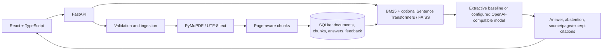

# EvidenceDesk

EvidenceDesk is a local-first document question-answering app. It indexes PDF and text documents, searches their passages, and returns answers with document, page, and excerpt citations. If the evidence score is below a configurable threshold, it abstains.

> **Current verified baseline:** the included synthetic evaluation run achieved Recall@5 **1.00**, MRR **0.975**, citation correctness proxy **0.92**, groundedness proxy **0.90**, and refusal decision accuracy **0.92** over 50 questions. This is a small, fictional, single-document test set, not a production benchmark or a human-reviewed quality claim. See [the recorded report](evaluation/results/v1.json) and [evaluation protocol](evaluation/README.md).

## What is implemented

- FastAPI backend with PDF/TXT upload, content validation, byte-size limit, SHA-256 duplicate detection, SQLite metadata, chunks, history, feedback, and source previews.
- PyMuPDF extraction with page numbers; pages with little extractable text are flagged as likely needing OCR.
- Overlapping page-aware chunks, BM25 keyword retrieval, optional Sentence Transformers + FAISS vectors, and weighted hybrid fusion.
- Literal extractive answer mode by default; optional OpenAI-compatible generation (including local compatible servers) constrained to retrieved excerpts. No key is checked into source.
- React and TypeScript UI for library management, search, cited responses, source excerpt preview, history, feedback, upload and removal.
- Synthetic v1 evaluation set with 40 answerable and 10 unanswerable examples and a reproducible metric runner.

## Architecture



Ingestion is synchronous in this first version, so successful upload responses mean indexing completed. The FAISS index is constructed for a query from the current corpus; embeddings are not yet persisted. This keeps the demo's state simple but is not appropriate for large production collections.

## Run locally

Requires Python 3.11+, Node.js 20+, and npm. From the project root:

```powershell
Copy-Item .env.example .env
python -m venv .venv
.\.venv\Scripts\Activate.ps1
python -m pip install -e "backend[dev]"
# Optional semantic vectors (downloads model weights on first use):
python -m pip install -e "backend[vector]"
uvicorn evidencedesk.api:app --app-dir backend/src --reload --port 8000
```

In a second terminal:

```powershell
cd frontend
npm install
npm run dev
```

Open <http://localhost:5173>. API health: <http://localhost:8000/api/health>. Uploaded files and SQLite data are stored under `ED_DATA_DIR` (default `./data`). The UI and default extractive mode do not send document content to an external service. The optional hosted generation provider sends retrieved excerpts to the configured endpoint; use it only when that is acceptable for your documents.

For a local OpenAI-compatible model server, set `ED_LLM_PROVIDER=openai-compatible`, `ED_LLM_MODEL` to a model served by that endpoint, and `ED_LLM_BASE_URL` to its local API base. For hosted use, also set `ED_LLM_API_KEY` in the untracked `.env`; never commit secrets. The default generator is an extractive sentence selector and does not require a model.

To enable that optional adapter, install `python -m pip install -e "backend[llm]"` in addition to the base backend dependencies.

## Docker

Docker Engine and Compose are required. Copy `.env.example` to `.env`, then run:

```sh
docker compose up --build
```

Open <http://localhost:8080>. The `evidencedesk_data` named volume retains uploaded documents and SQLite data. Back it up and restrict host access. To use local semantic vectors in the backend image, add the `vector` extra to the backend install step and mount/cache model weights; this increases image size and startup requirements.

## Tests and evaluation

With the `dev` extra installed:

```sh
pytest backend/tests -q
python evaluation/build_dataset.py
python evaluation/run.py
```

The evaluator writes `evaluation/results/latest.json` and a versioned snapshot at `evaluation/results/v1.json`. It measures retrieval Recall@5 and MRR against the exact supporting sentence, citation correctness and answer groundedness proxies based on evidence containment, refusal decision accuracy, wall-clock retrieval/answer latency, and provider cost when known. The recorded zero API cost is for the local extractive provider only; it excludes compute and hosting. Automated evidence containment is not human judgment, and p95 on 50 fast local cases is not a service-level guarantee.

## Repository map

```text
backend/src/evidencedesk/  API, config, SQLite, ingestion, retrieval, generation
backend/tests/            API integration and core unit tests
frontend/src/             React/TypeScript application and responsive styles
evaluation/dataset/        versioned 50-case synthetic question set
evaluation/results/        versioned measured report
sample_docs/               synthetic demo handbook
docs/                      security, privacy, and trade-offs
```

## Limitations and risks

- OCR is not performed. Image-only/scanned PDF pages are flagged; install and integrate an OCR engine before relying on them.
- PDF modification dates older than the configurable threshold are flagged; TXT documents have no source-date detection. A simple cross-document numeric mismatch heuristic surfaces possible conflicts, but no adjudication logic resolves which source is newer or authoritative.
- The app is a single local workspace with no authentication, user isolation, background queue, rate limiting, audit controls, or multi-tenant boundaries. Do not expose it directly to an untrusted network.
- Semantic index construction is per request; no persistent FAISS index or reranker exists yet. Large libraries need batch embedding, durable index lifecycle, and load testing.
- Demo handbook facts and all 50 evaluation questions are synthetic. Obtain real public documents and build a human-reviewed, versioned test set before making quality claims.
- There is no screenshot in this release: this execution environment did not have the frontend dependencies or browser runtime available, so a UI capture could not be truthfully verified.

See [design trade-offs and privacy notes](docs/limitations-and-security.md) for additional detail.
